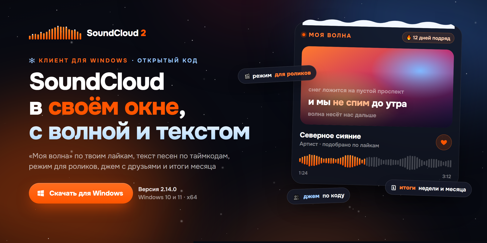
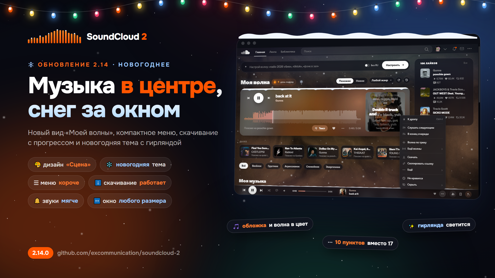
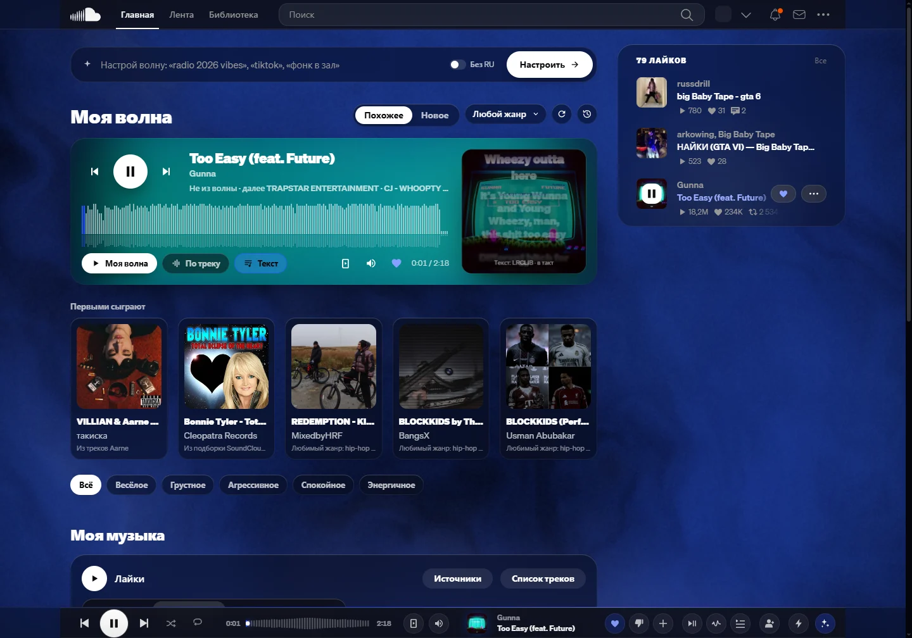
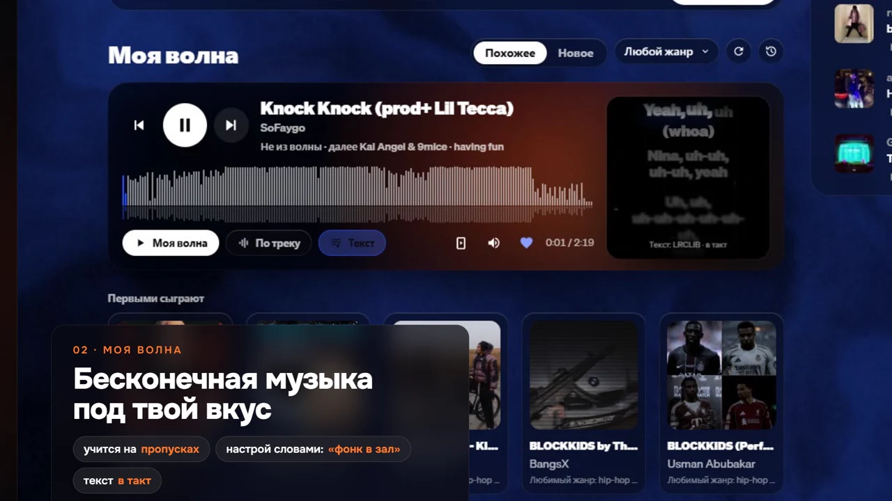
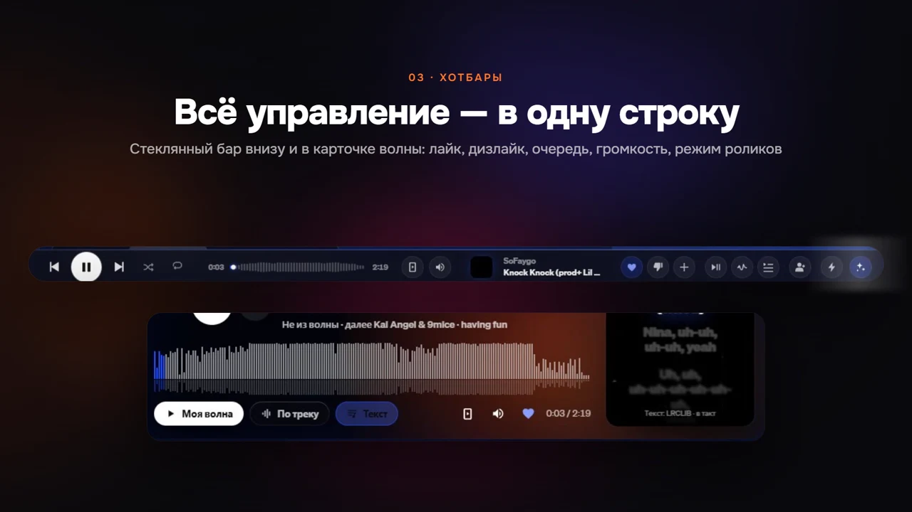
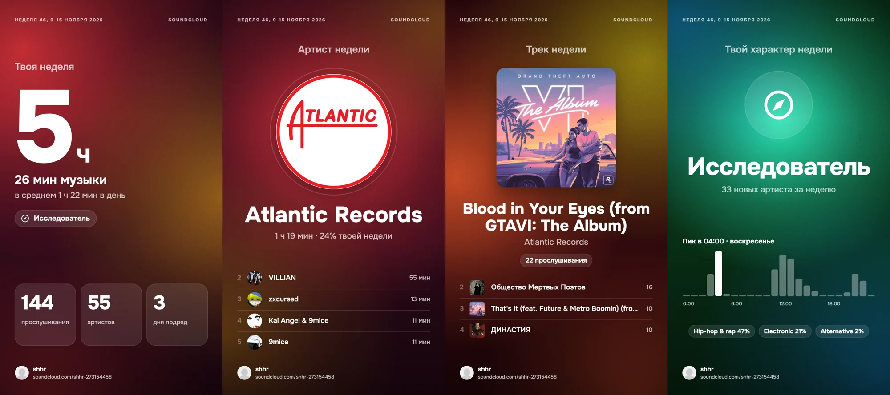
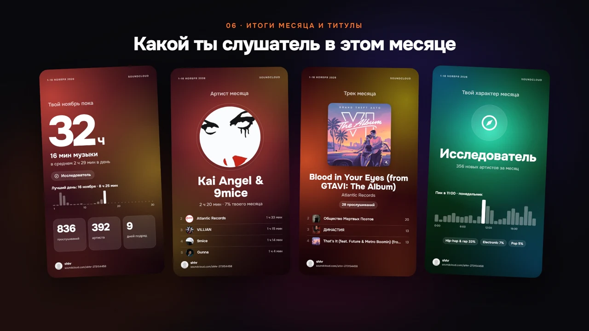
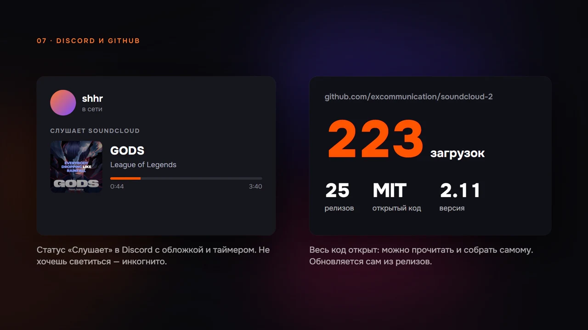
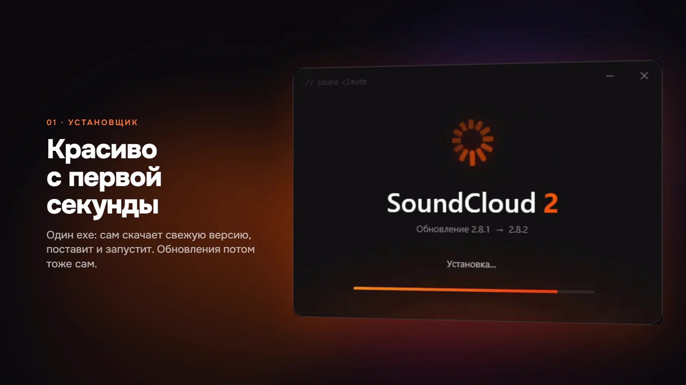

<div align="center">

<a href="https://github.com/excommunication/soundcloud-2/releases/latest"></a>

[](https://github.com/excommunication/soundcloud-2/releases/latest)
[](https://github.com/excommunication/soundcloud-2/releases)
[](LICENSE)

### <a href="https://github.com/excommunication/soundcloud-2/releases/latest/download/SoundCloud-2-Setup.exe">⬇️ Скачать для Windows</a>

Один установщик, интернет для установки не нужен. Версия 2.14.0, Windows 10 и 11, x64.

<sub>
<a href="#features">Возможности</a> ·
<a href="#whats-new">Что нового</a> ·
<a href="#install">Установка</a> ·
<a href="#faq">FAQ</a> ·
<a href="#build">Сборка</a> ·
<a href="https://github.com/excommunication/soundcloud-2/releases">Все релизы</a>
</sub>

</div>

<br>


Это soundcloud.com в своём окне, только с «Моей волной», которая подбирает музыку по твоим лайкам. Текст песни идёт по таймкодам, а режим для роликов делает из обложки кадр для TikTok. Клиент сам обновляется из релизов этого репозитория.

<a id="why"></a>

## 💡 Почему SoundCloud 2

- **Весь SoundCloud, ничего не отрезано.** Внутри обычный soundcloud.com с твоим аккаунтом, лайками и плейлистами. Клиент добавляет своё поверх, а не заменяет сайт.
- **Музыка, которая не заканчивается.** «Моя волна» подбирает похожее на твои лайки и учится на пропусках и дослушиваниях.
- **Красиво и под бит.** Живой фон в цветах обложки, стеклянные панели, обложка подпрыгивает на басах. Если компьютер слабый, есть режимы «Облегчённо», «Супер лайт» и «Без эффектов».
- **Твоя статистика остаётся у тебя.** История прослушиваний, итоги и титулы считаются на компьютере и никуда не отправляются.
- **Открытый код, MIT.** Можно прочитать, собрать самому и предложить правку.

<a id="features"></a>

## 🧭 Возможности

<table>
  <tr>
    <td width="33%" valign="top">
      <h3>📻 <a href="#wave">Моя волна</a></h3>
      Бесконечная очередь по твоим лайкам. Настраивается словами, умеет «Без русского».
    </td>
    <td width="33%" valign="top">
      <h3>🎤 <a href="#wave">Текст песен</a></h3>
      Строки подсвечиваются по таймкодам. Тексты из LRCLIB, запасной источник Genius.
    </td>
    <td width="33%" valign="top">
      <h3>✨ <a href="#look">Стекло и анимации</a></h3>
      Хотбар внизу окна, живой WebGL-фон, плавная смена трека и вертикальная громкость.
    </td>
  </tr>
  <tr>
    <td valign="top">
      <h3>🎬 <a href="#clips">Режим для роликов</a></h3>
      Обложка на всё окно, текст поверх, кадр 9:16 и запись в MP4 одной клавишей.
    </td>
    <td valign="top">
      <h3>📊 <a href="#history">История</a></h3>
      Часы музыки, артисты, жанры и дни подряд. Журнал лежит только на твоём компьютере.
    </td>
    <td valign="top">
      <h3>🗓 <a href="#recap">Итоги и титулы</a></h3>
      Карточки 9:16 за неделю, месяц и год. Твой титул: «Ночная сова», «Исследователь» и другие.
    </td>
  </tr>
  <tr>
    <td valign="top">
      <h3>👥 <a href="#more">Джем</a></h3>
      Совместное прослушивание по коду комнаты с общей очередью (<kbd>Ctrl</kbd>+<kbd>Shift</kbd>+<kbd>J</kbd>).
    </td>
    <td valign="top">
      <h3>❤️ <a href="#more">Лайки и скачивание</a></h3>
      Сетка лайков с датами и серией 🔥, скачивание трека из меню по правому клику.
    </td>
    <td valign="top">
      <h3>💬 <a href="#discord">Discord</a></h3>
      Статус «Слушает SoundCloud» с обложкой и таймером. Есть инкогнито.
    </td>
  </tr>
</table>

<details>
<summary><b>📑 Содержание</b></summary>

- [Почему SoundCloud 2](#why)
- [Возможности](#features)
- [Что нового в 2.14](#whats-new)
- [Моя волна](#wave)
- [Хотбары, стекло и анимации](#look)
- [История](#history)
- [Итоги и титулы](#recap)
- [Режим «Для роликов»](#clips)
- [Discord](#discord)
- [Ещё возможности](#more)
- [Установка и системные требования](#install)
- [FAQ](#faq)
- [Открытый код и сборка из исходников](#build)
- [Полный ролик](#video)
- [Лицензия и благодарности](#license)

</details>

<a id="whats-new"></a>

## ❄️ Что нового в 2.14



Новый вид главной, где музыка в центре, и новогодняя тема.

- 🎨 **Дизайн «Сцена».** Под обложкой цветное свечение, сыгранная часть волны в цветах обложки, тонкие ползунки с градиентом. Кнопки без обводок, второстепенные появляются при наведении на карточку.
- ❄️ **Новогодняя тема.** Падающий снег в три слоя, светящаяся гирлянда в шапке, снег на карточке волны, зимний фон с северным сиянием. Сама включается с 15 декабря по 14 января, вручную включается в «Оформлении». На паузе, когда окно не в фокусе.
- ☰ **Одно меню трека везде.** «⋯» в плеере, на карточке волны, в «Далее», в списках и режиме роликов. Десять главных пунктов и подменю «Ещё волны», «Ещё» и «Скрыть». Правый клик работает по всей строке трека.
- ⬇️ **Скачивание работает.** Оригинал автора, MP3 или AAC в `.m4a`. Карточка с обложкой, прогрессом и кнопкой «Показать в папке».
- ↔️ **Окно любого размера.** «Далее» всегда одной строкой, число карточек зависит только от ширины, панель лайков не обрезается.
- 🔔 **Звуки мягче.** Тихие округлые ноты на лайк и дизлайк.
- ⚡ **Легче для слабых ПК.** Меньше размытия подложки, полоса прогресса без перерисовки 30 раз в секунду, подборки вне экрана не рисуются.

<details>
<summary><b>Недавние версии: 2.12 и 2.13</b></summary>

- **2.13.5.** 22 исправления: отметки волны и миксы не стираются при сбое файла, бэкап без отката, джем без «призраков», коллажи «Your Mix» на всю обложку.
- **2.13.1–2.13.4.** Меню по правому клику разложено по группам, огонёк серии рядом с «Моей волной», история прослушивания в обзоре библиотеки, обновление маленькой карточкой в углу, надёжное скачивание с понятным сообщением для защищённых треков.
- **2.13.0.** Сетка лайков с кнопкой «убрать лайк» и серией 🔥, «Скачать» в меню по правому клику, история поиска, автозамена без slowed, sped up и перезаливов, подключение YouTube из буфера.
- **2.12.8.** Кнопка «Мои лайки» и дата каждого лайка, библиотека в стиле клиента, плавное изменение размера окна.
- **2.12.5–2.12.7.** Вместо 30-секундных отрывков Go+ играет полный трек: клиент находит ту же песню на YouTube.
- **2.12.4.** Джем с общей очередью и сохранением комнаты, индикатор повтора.
- **2.12.0–2.12.3.** Джем по <kbd>Ctrl</kbd>+<kbd>Shift</kbd>+<kbd>J</kbd>, режимы «Супер лайт» и «Без эффектов», нижняя панель плеера, превью на панели задач.

Полная история изменений лежит в [релизах](https://github.com/excommunication/soundcloud-2/releases).

</details>

<a id="wave"></a>

## 📻 Моя волна

Бесконечная очередь из похожего на твои лайки. Волна учится на пропусках и дослушиваниях.



- **Настрой волну словами.** Напиши «фонк в зал» или «tiktok», и клиент найдёт актуальные треки и вплетёт их в волну. Переключатель «Без русского» убирает русскоязычные треки из рекомендаций.
- **Текст песен синхронно.** Строки подсвечиваются по таймкодам. Текст ищется в LRCLIB, запасной источник: Genius. Если таймкодов нет, показывается обычный текст.
- **Карточка волны.** Трек, волна, кнопки и текст песни на обложке. Кнопка режима роликов и вертикальная громкость прямо в карточке.



<a id="look"></a>

## ✨ Хотбары, стекло и анимации

Нижний бар с лайком, дизлайком, очередью, громкостью и режимом роликов. Всё, что нужно под рукой, без лишних окон.



- **Плавная смена трека.** В «Моей волне» прошлые название и обложка уезжают, новые въезжают следом, волна трека вырастает.
- **Под бит.** Обложка трясётся и подсвечивается на ударах баса, фон дышит, на каждой новой строке текста толчок. Темп клиент определяет по звуку.
- **Переливы WebGL и стекло.** Живой фон за сайтом в цветах играющей обложки, панели поверх него стеклянные.
- **Вертикальная громкость.** Один ползунок над значком: тянуть, крутить колесом, стрелками. Щелчок по значку выключает звук.
- **Тихие края и плавные стыки.** Тишина в начале и в конце трека перематывается, следующий трек плавно набирает громкость.
- **Режимы эффектов.** «Полные эффекты», «Облегчённо», «Супер лайт» и «Без эффектов» переключаются в меню кнопки оформления.

<a id="history"></a>

## 📊 История

Журнал прослушиваний лежит только на твоём компьютере. Экран «История» (<kbd>Ctrl</kbd>+<kbd>H</kbd>) показывает время, прослушивания, артистов и дни подряд за выбранный период: 7 дней, 30 дней, год или всё время.


Ниже графика идут топы артистов, треков и жанров, а также график «Когда ты слушаешь» по часам суток.

<a id="recap"></a>

## 🗓 Итоги и титулы

Итоги недели, месяца и года — это карточки 9:16 в цветах обложки. Каждая сохраняется в PNG. Кнопка «Итоги месяца» стоит прямо на экране «История».

Карточки для недели и месяца идут по порядку: неделя, артист, трек и твой характер.





В окне итогов выбираешь неделю, месяц или год, прошлый период и цвет карточек. Потом копируешь или сохраняешь картинку.


<table>
  <tr>
    <td width="40%" valign="top">
      
    </td>
    <td width="60%" valign="top">
      <b>Титул</b> — характер слушателя за период. Он выводится на карточке «Твой характер».<br><br>
      Правила проверяются сверху вниз, первое подошедшее правило даёт титул. Если ни одно не подошло, будет «Свой ритм».
    </td>
  </tr>
</table>

<details>
<summary><b>Все титулы и правила</b></summary>

| Титул | Когда выдаётся |
|---|---|
| **Разгон** | Меньше 5 засчитанных прослушиваний за период. |
| **Ночная сова** | 35% и больше музыки с полуночи до пяти утра. |
| **Верный фанат** | 40% и больше времени с одним артистом. |
| **На репите** | Один трек звучал 8 и больше раз, и это не меньше 20% всех прослушиваний. |
| **Исследователь** | Половина и больше артистов за период — новые для тебя, и всего артистов не меньше 8. |
| **Ранняя пташка** | 35% и больше музыки до десяти утра. |
| **Марафонец** | В среднем 3 часа музыки и больше в день. |
| **Меломан без границ** | Четыре жанра и больше, и ни один не занимает 35% и больше. |
| **Свой ритм** | Ни одно из правил выше не подошло. |

</details>

<a id="clips"></a>

## 🎬 Режим «Для роликов»

Кнопка режима стоит в карточке «Моей волны» и в нижнем баре рядом с громкостью. Нажми её, и обложка играющего трека займёт всё окно, а текст песни пойдёт прямо по ней. Щелчок по обложке ставит трек на паузу, щелчок по строке в «Потоке» перематывает к ней. Полосу времени можно тянуть.

Два стиля текста. «Поток»: строки едут по обложке, слова текущей загораются в такт. «Удар»: одна строка капсом, слова выпрыгивают по одному.

<table>
  <tr>
    <td colspan="2" valign="top">
      <br>
      <b>Для роликов · «Поток»</b><br>
      <sub>Строки едут по обложке, слова текущей загораются в такт, обложка трясётся под бит.</sub>
    </td>
  </tr>
  <tr>
    <td width="40%" valign="top">
      <br>
      <b>Кадр 9:16 · «Удар»</b><br>
      <sub>Вертикальный кадр для TikTok и Reels, слова выпрыгивают по одному.</sub>
    </td>
    <td width="60%" valign="top">
      <br>
      <b>Для роликов · «Удар»</b><br>
      <sub>Обложка на весь кадр, текст прыгает в такт музыке.</sub>
    </td>
  </tr>
</table>

Внизу панель: соседние треки, перемотка на 10 секунд, пауза, громкость и лайк. Обе панели прячутся, когда мышь не двигается две секунды, поэтому в ролик они не попадают.

Кнопка записи (<kbd>R</kbd>) снимает кадр со звуком трека в MP4 и кладёт файл в `Видео\SoundCloud Clips`: после отсчёта 3-2-1, остановка тем же <kbd>R</kbd> или <kbd>Esc</kbd>. В кадре 9:16 ролик выходит 1080×1920, сразу под TikTok.

<details open>
<summary><b>⌨️ Клавиши режима</b></summary>

| Клавиша | Действие |
|---|---|
| <kbd>V</kbd> | Кадр 9:16 по центру: во всю высоту окна, в узком окне во всю ширину |
| <kbd>L</kbd> | Стиль текста: «Поток» → «Удар» → без текста |
| <kbd>P</kbd> | Текст сбоку: обложка слева чистая, текст отдельной колонкой справа (в 9:16 под обложкой) |
| <kbd>H</kbd> | Спрятать или показать подписи и полосу времени |
| <kbd>F</kbd> | Полный экран |
| <kbd>R</kbd> | Запись ролика в MP4, с <kbd>Shift</kbd> ровно 15 секунд |
| <kbd>B</kbd> | Эффекты бита: расслоение цвета, кольца, искры, толчки |
| <kbd>Q</kbd> | Значок sc2 в углу кадра: QR-код на репозиторий с живым значком клиента посередине |
| <kbd>M</kbd> | Выключить или включить звук |
| <kbd>N</kbd> | Следующий трек, с <kbd>Shift</kbd> предыдущий |
| <kbd>Пробел</kbd> | Пауза и продолжение |
| <kbd>←</kbd> <kbd>→</kbd>, колесо мыши | Перемотка на 5 секунд, с <kbd>Shift</kbd> на 15 |
| <kbd>Esc</kbd> | Остановить запись; иначе свернуть режим (в полном экране первый Esc выходит из него) |

</details>

<a id="discord"></a>

## 💬 Discord

Клиент показывает в Discord статус «Слушает». Есть режим инкогнито: он включается из меню в трее.

<br>
<sub>Карточка статуса в Discord: обложка, трек и таймер. Инкогнито прячет её.</sub>

<br>
<sub>Слева статус в Discord, справа открытый код: 223 загрузки, 25 релизов, версия 2.11.</sub>

<a id="more"></a>

## 🧩 Ещё возможности

| | |
|---|---|
| 👥 **Джем** | Совместное прослушивание по коду комнаты (<kbd>Ctrl</kbd>+<kbd>Shift</kbd>+<kbd>J</kbd>): общая очередь с подписью, кто добавил трек, комната сохраняется после перезапуска клиента. |
| ❤️ **Лайки** | Кнопка «Мои лайки», сетка с кнопкой «убрать лайк» при наведении, дата каждого лайка и серия 🔥: сколько дней подряд ты ставишь лайки. |
| ⬇️ **Скачивание** | «Скачать» в меню по правому клику сохраняет трек в `Загрузки\SoundCloud`. Если правообладатель закрыл трек защитой, клиент так и скажет. |
| 🎧 **Полные треки вместо отрывков** | Вместо 30-секундных отрывков Go+ клиент может играть ту же песню целиком с YouTube. YouTube подключается в пару кликов из уведомления. |
| 📡 **Пятничный радар** | Выпуск новых релизов от артистов, которых ты слушаешь, с архивом. |
| 🔎 **История поиска** | Последние запросы появляются под пустым полем поиска. |
| 🛡 **Блокировка рекламы** | Встроенный блокировщик рекламы и переключатели, которые прячут промо-блоки, концерты поблизости и предложения Artist Pro. |
| 💾 **Резервные копии** | Один файл с настройками, отметками и журналом волны и сохранёнными миксами: сохранить, восстановить, плюс автокопия в выбранную папку. |
| 🌐 **Прокси и вебхуки** | Подключение через прокси и вебхук, который отправляет данные трека на твой адрес, когда он доиграет до заданного процента. |
| 🪟 **Windows** | Кнопки управления и превью трека на панели задач, сворачивание в трей. |
| 🔐 **Вход через браузер** | Google не пускает во встроенные окна, поэтому клиент предлагает войти в обычном браузере и забирает сессию оттуда (<kbd>Ctrl</kbd>+<kbd>Shift</kbd>+<kbd>L</kbd>). Подробности в [FAQ](#faq). |
| ⬆️ **Автообновление** | Новая версия скачивается в фоне и ставится, когда ты закроешь клиент. Проверить вручную можно кнопкой «Проверить сейчас». |

<a id="install"></a>

## 💿 Установка и системные требования

1. Скачай [`SoundCloud-2-Setup.exe`](https://github.com/excommunication/soundcloud-2/releases/latest/download/SoundCloud-2-Setup.exe) со страницы [последнего релиза](https://github.com/excommunication/soundcloud-2/releases/latest).
2. Запусти его. Если SmartScreen предупредит, нажми «Подробнее» → «Выполнить в любом случае» (почему так, написано в [FAQ](#faq)).
3. Войди в свой аккаунт SoundCloud, и можно слушать. Настройки открываются клавишей <kbd>F1</kbd>.

`SoundCloud-2-Setup.exe` — единственный установщик. Окно установки вшито в него, поэтому для установки интернет не нужен. Имя файла в каждом релизе одно и то же.



| | Требования |
|---|---|
| **Система** | Windows 10 или 11, 64-бит (x64) |
| **Интернет** | Нужен для музыки и обновлений, для самой установки не нужен |
| **Аккаунт** | Аккаунт SoundCloud: вход по почте, Apple, Facebook или Google через браузер |
| **Видеокарта** | Не обязательна: на слабом железе включи «Облегчённо», «Супер лайт» или «Без эффектов» |

<a id="faq"></a>

## ❓ FAQ

<details>
<summary><b>SmartScreen пишет «Windows защитила ваш компьютер»</b></summary>

Сборка подписана только VMP-подписью Castlabs для Widevine, сертификата издателя Windows у неё нет. Нажми «Подробнее» → «Выполнить в любом случае».

</details>

<details>
<summary><b>Зачем Widevine и почему некоторые треки нельзя скачать</b></summary>

Часть треков SoundCloud отдаёт только зашифрованным потоком Widevine. Клиент собран на Electron от Castlabs с поддержкой Widevine, поэтому такие треки играют как на сайте. Скачать их нельзя: правообладатель закрыл трек защитой, и SoundCloud даёт его только слушать. В этом случае клиент так и пишет, это не сбой.

</details>

<details>
<summary><b>Как работают обновления</b></summary>

Клиент сам проверяет релизы этого репозитория, скачивает новую версию в фоне и ставит её, когда ты закроешь окно. Новая версия появляется маленькой карточкой в углу. Проверить вручную можно кнопкой «Проверить сейчас».

</details>

<details>
<summary><b>Где настройки и история</b></summary>

В `%APPDATA%\soundcloud-desktop`. Там лежат настройки, журнал волны и история. Другие клиенты SoundCloud на компьютере эта папка не трогает. Окно настроек открывается клавишей <kbd>F1</kbd>. Настройки и волну можно перенести на другой компьютер резервной копией.

</details>

<details>
<summary><b>Что клиент отправляет наружу</b></summary>

История прослушиваний, итоги, титулы и отметки волны хранятся только на твоём компьютере. Сеть нужна там, где без неё никак: сам SoundCloud, поиск текста песни в LRCLIB и Genius, YouTube для полных треков, сервер джема (только когда ты в джеме), Discord для статуса (его прячет инкогнито) и релизы GitHub для обновлений. Вебхук уходит только на адрес, который ты сам указал, и только если он включён.

</details>

<details>
<summary><b>Как войти через Google</b></summary>

Google не пускает во встроенные браузеры и приложения вроде Electron: окно клиента пишет, что приложение небезопасно, ещё до ввода пароля. Обойти это нельзя, поэтому клиент сам открывает диалог «Вход через браузер» (его же вызывает <kbd>Ctrl</kbd>+<kbd>Shift</kbd>+<kbd>L</kbd>):

1. Нажми «Открыть SoundCloud» и войди там через Google в своём обычном браузере.
2. Поставь расширение [Cookie-Editor](https://cookie-editor.com/) (кнопка «Расширение»), открой его на странице soundcloud.com и нажми Export → JSON. Всё скопируется в буфер обмена.
3. Вернись в клиент и нажми «Войти из буфера». Страница перезагрузится уже с твоим входом.

Клиент берёт из буфера только две cookie входа, `oauth_token` и `oauth_refresh_token`, и никуда их не отправляет. Первая живёт сутки, вторая продлевает её, поэтому нужен именно экспорт через Cookie-Editor: одного токена хватит на день. Войти можно и по почте: если аккаунт создавался через Google, «Забыли пароль?» на странице входа задаст к нему пароль.

</details>

<details>
<summary><b>Память растёт, если много пропускать треки</b></summary>

Плеер самого SoundCloud копит скачанное аудио после каждого пропуска. Клиент следит за этим и сам перезагружает страницу, когда она раздулась и музыка на паузе (или в крайнем случае прямо во время игры): очередь и позиция трека возвращаются сами.

</details>

<details>
<summary><b>Текст песни не нашёлся</b></summary>

LRCLIB и Genius знают не все треки. В этом случае показывается текст без подсветки, либо текста нет совсем.

</details>

<details>
<summary><b>Почему в релизе один exe</b></summary>

С 2.10.0 `SoundCloud-2-Setup.exe` — единственный установщик: окно установки вшито в него, интернет для установки не нужен. Имя файла в каждом релизе одно и то же.

</details>

<a id="build"></a>

## 🛠 Открытый код и сборка из исходников

Проект открытый, лицензия MIT.

Нужны Windows 10 или 11 (x64), Node.js 24 и pnpm. Версия pnpm закреплена в `package.json` (поле `packageManager`). Клиент собирается на Electron от Castlabs с поддержкой Widevine.

```bash
pnpm i               # зависимости
pnpm dev             # запуск клиента из исходников
pnpm test            # тесты
pnpm typecheck       # проверка типов
pnpm lint            # ESLint
pnpm build-setup     # окно установки, вшивается в установщик (как в CI)
pnpm build-win       # установщик: build/SoundCloud-2-Setup.exe
```

Сборка, которую запускает CI, описана в [`.github/workflows/release.yml`](.github/workflows/release.yml). Релиз по тегу `vX.Y.Z` выкладывает один установщик `SoundCloud-2-Setup.exe` и `latest.yml` с blockmap для автообновления.

<a id="video"></a>

## 🎞 Полный ролик

Ролик на 50 секунд со всеми фичами: [promo/sc2-promo.mp4](promo/sc2-promo.mp4). В нём нет музыки.

<br>
<sub>Финал ролика: кнопка «Скачать для Windows» и репозиторий github.com/excommunication/soundcloud-2.</sub>

<a id="license"></a>

## 📄 Лицензия и благодарности

Проект распространяется по лицензии [MIT](LICENSE). Он основан на [soundcloud-desktop](https://github.com/zxczxczxczxczxczxc1111/soundcloud-desktop) и не связан с SoundCloud. Товарный знак SoundCloud принадлежит его владельцу.

Спасибо [LRCLIB](https://lrclib.net) и Genius за тексты песен, [Castlabs](https://github.com/castlabs/electron-releases) за Electron с Widevine и всем, кто пишет об ошибках в [Issues](https://github.com/excommunication/soundcloud-2/issues).

<div align="center">

<br>


<sub>Нравится клиент? Поставь ⭐ репозиторию, это помогает его найти.</sub>

</div>
