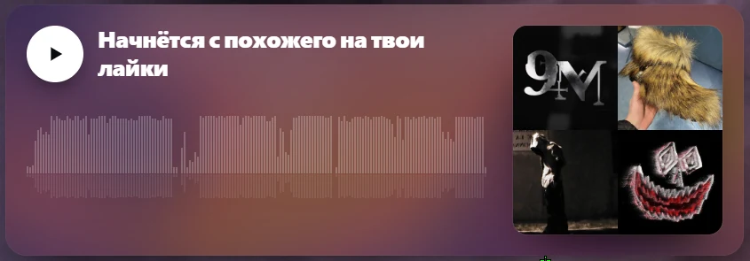

<div align="center">


# SoundCloud 2

*A SoundCloud desktop client for Windows: a smart "My Wave", synced lyrics and a 9:16 video mode.*

[](https://github.com/excommunication/soundcloud-2/releases/latest)
[](https://github.com/excommunication/soundcloud-2/releases)
[](LICENSE)

<br>

<a href="https://github.com/excommunication/soundcloud-2/releases/latest/download/SoundCloud-2-Setup.exe"><b>Скачать для Windows</b></a>

Один установщик, интернет для установки не нужен. Версия 2.10.0, Windows 10 и 11, x64.

</div>


Это soundcloud.com в своём окне, только с «Моей волной», которая подбирает музыку по твоим лайкам, текстом песни под каждый трек и режимом для съёмки роликов. Клиент сам обновляется из релизов этого репозитория.

## ✨ Возможности

- 📻 **Моя волна.** Бесконечная очередь из похожего на твои лайки. Учится на пропусках и дослушиваниях.
- 🔎 **Настрой волну словами.** Напиши «фонк в зал» или «tiktok», и клиент найдёт актуальные треки и вплетёт их в волну. Переключатель «Без русского» убирает русскоязычные треки из рекомендаций.
- 🎤 **Текст песен синхронно.** Строки подсвечиваются по таймкодам. Текст ищется в LRCLIB, запасной источник: Genius. Если таймкодов нет, показывается обычный текст.
- 🎬 **Режим «Для роликов».** Обложка играющего трека на всё окно, текст песни прямо на обложке в двух стилях: «Поток» (строки едут, слова загораются в такт) и «Удар» (одна строка капсом, слова выпрыгивают по одному). Кадр 9:16 для TikTok одной клавишей. Подробнее ниже.
- 🥁 **Под бит.** Обложка трясётся и подсвечивается на ударах баса, фон дышит, на каждой новой строке текста толчок. Темп клиент определяет по звуку.
- 🔁 **Плавная смена трека.** В «Моей волне» прошлые название и обложка уезжают, новые въезжают следом, волна трека вырастает.
- 🌈 **Переливы WebGL и стекло.** Живой фон за сайтом в цветах играющей обложки, панели поверх него стеклянные.
- 🔊 **Вертикальная громкость.** Один вертикальный ползунок над значком в карточке «Моей волны» и в нижнем баре: тянуть, крутить колесом, стрелками. Щелчок по значку выключает звук.
- 🔇 **Тихие края и плавные стыки.** Тишина в начале и в конце трека перематывается, следующий трек плавно набирает громкость.
- 📡 **Пятничный радар.** Выпуск новых релизов от артистов, которых ты слушаешь, с архивом.
- 🕘 **История прослушиваний.** Журнал лежит только на твоём компьютере.
- 💬 **Discord.** Статус «Слушает» в Discord, есть режим инкогнито.
- 🔐 **Вход через Google.** Окно входа Google, Apple и Facebook. Сессия общая с сайтом, после входа клиент сразу авторизован.
- ⬆️ **Автообновление.** Новая версия скачивается в фоне и ставится, когда ты закроешь клиент. Проверить вручную можно кнопкой «Проверить сейчас».

История изменений по версиям лежит в [релизах](https://github.com/excommunication/soundcloud-2/releases).

## 🖼 Скриншоты

<table>
  <tr>
    <td colspan="2" valign="top">
      <br>
      <b>Моя волна</b><br>
      <sub>Карточка в цветах обложки, текст песни на обложке, кнопка режима роликов и вертикальная громкость.</sub>
    </td>
  </tr>
  <tr>
    <td width="60%" valign="top">
      <br>
      <b>Для роликов · «Поток»</b><br>
      <sub>Строки едут по обложке, слова текущей загораются в такт, обложка трясётся под бит.</sub>
    </td>
    <td width="40%" valign="top">
      <br>
      <b>Кадр 9:16 · «Удар»</b><br>
      <sub>Вертикальный кадр для TikTok и Reels, слова выпрыгивают по одному.</sub>
    </td>
  </tr>
</table>

## 🎬 Режим «Для роликов»

Кнопка режима стоит в карточке «Моей волны» и в нижнем баре рядом с громкостью. Нажми её, и обложка играющего трека займёт всё окно, а текст песни пойдёт прямо по ней. Щелчок по обложке ставит трек на паузу, щелчок по строке в «Потоке» перематывает к ней. Полосу времени можно тянуть.

Панель кнопок прячется, когда мышь не двигается две секунды, поэтому в ролик она не попадает.

| Клавиша | Действие |
|---|---|
| <kbd>V</kbd> | Кадр 9:16 по центру: во всю высоту окна, в узком окне во всю ширину |
| <kbd>L</kbd> | Стиль текста: «Поток» → «Удар» → без текста |
| <kbd>H</kbd> | Спрятать или показать подписи и полосу времени |
| <kbd>F</kbd> | Полный экран |
| <kbd>Пробел</kbd> | Пауза и продолжение |
| <kbd>←</kbd> <kbd>→</kbd>, колесо мыши | Перемотка на 5 секунд, с <kbd>Shift</kbd> на 15 |
| <kbd>Esc</kbd> | Свернуть режим (в полном экране первый Esc выходит из него) |

## 🛠 Сборка из исходников

Нужны Windows 10 или 11 (x64), Node.js 24 и pnpm. Версия pnpm закреплена в `package.json` (поле `packageManager`).

```bash
pnpm i               # зависимости
pnpm dev             # запуск клиента из исходников
pnpm test            # тесты
pnpm typecheck       # проверка типов
pnpm build-setup     # окно установки, вшивается в установщик (как в CI)
pnpm build-win       # установщик: build/SoundCloud-2-Setup.exe
```

Сборка, которую запускает CI, описана в `.github/workflows/release.yml`. Релиз по тегу `vX.Y.Z` выкладывает один установщик `SoundCloud-2-Setup.exe` и `latest.yml` с blockmap для автообновления.

## ❓ FAQ

**SmartScreen пишет «Windows защитила ваш компьютер».** Сборка подписана только VMP-подписью Castlabs для Widevine, сертификата издателя Windows у неё нет. Нажми «Подробнее» → «Выполнить в любом случае».

**Где настройки и история?** В `%APPDATA%\soundcloud-desktop`. Там лежат настройки, журнал волны и история. Другие клиенты SoundCloud на компьютере эта папка не трогает. Окно настроек открывается клавишей <kbd>F1</kbd>.

**Вход через Google не проходит.** Google иногда отказывает во входе в окне клиента. Закрой окно, попробуй ещё раз или войди по почте: клиент сам подскажет этот путь.

**Текст песни не нашёлся.** LRCLIB и Genius знают не все треки. В этом случае показывается текст без подсветки, либо текста нет совсем.

**Почему в релизе один exe?** С 2.10.0 `SoundCloud-2-Setup.exe` — единственный установщик: окно установки вшито в него, интернет для установки не нужен. Имя файла в каждом релизе одно и то же.

## 📄 Лицензия

Проект распространяется по лицензии [MIT](LICENSE). Он основан на [soundcloud-desktop](https://github.com/zxczxczxczxczxczxc1111/soundcloud-desktop) и не связан с SoundCloud. Товарный знак SoundCloud принадлежит его владельцу.
