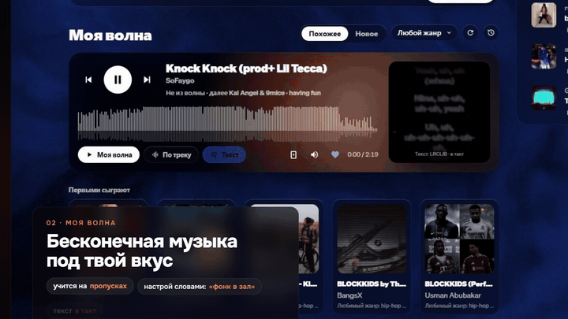
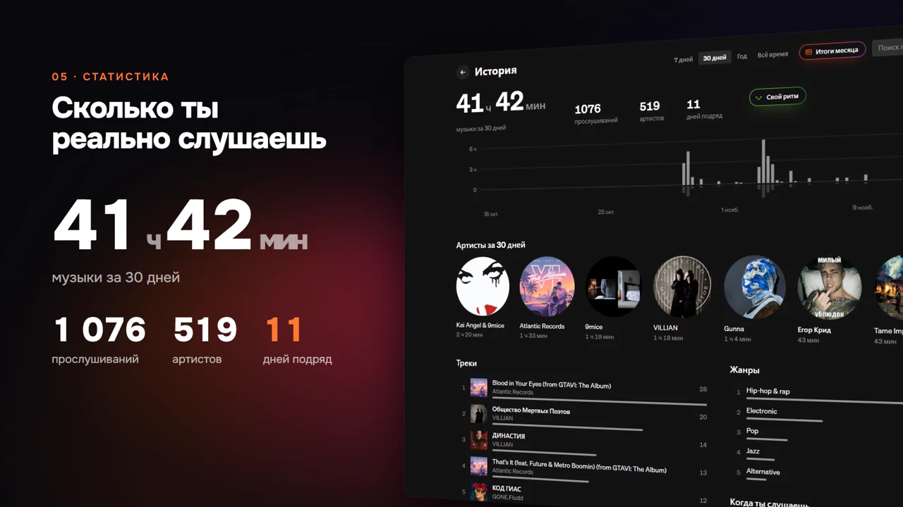
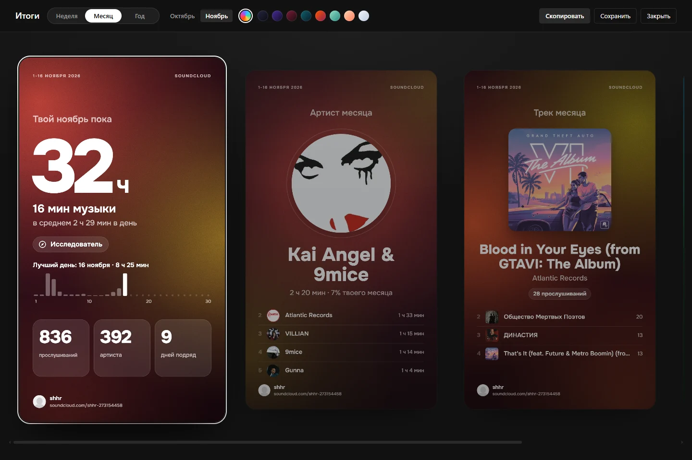
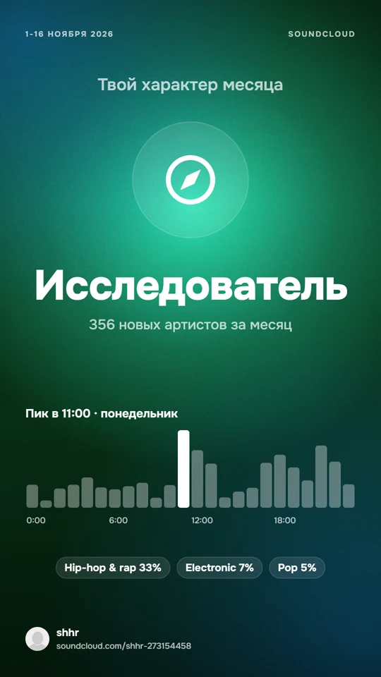
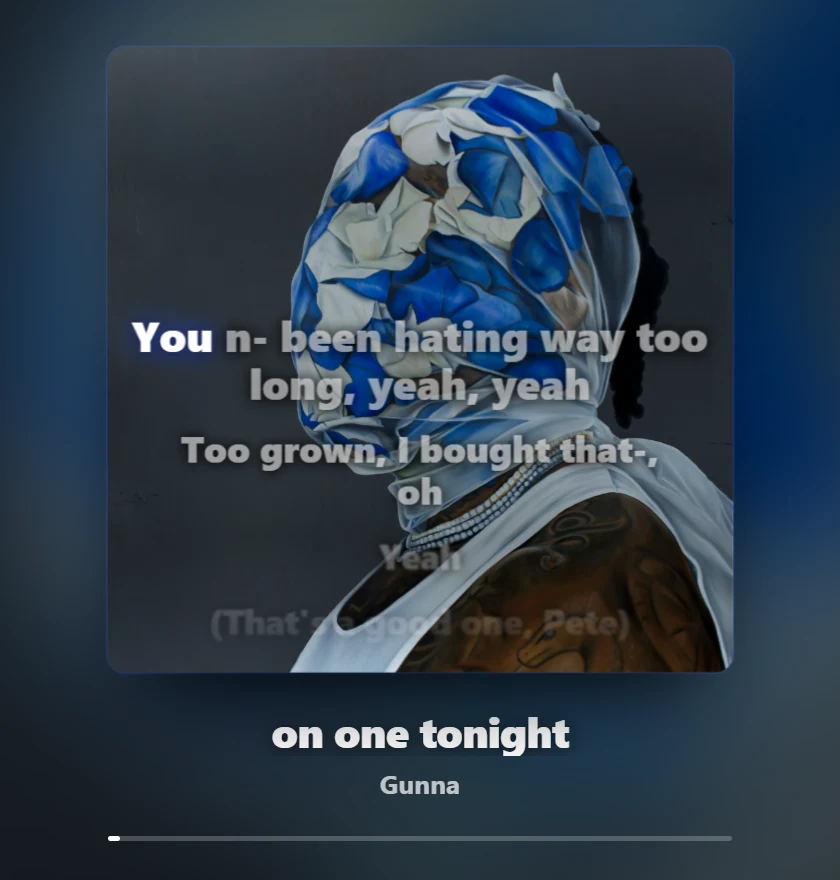
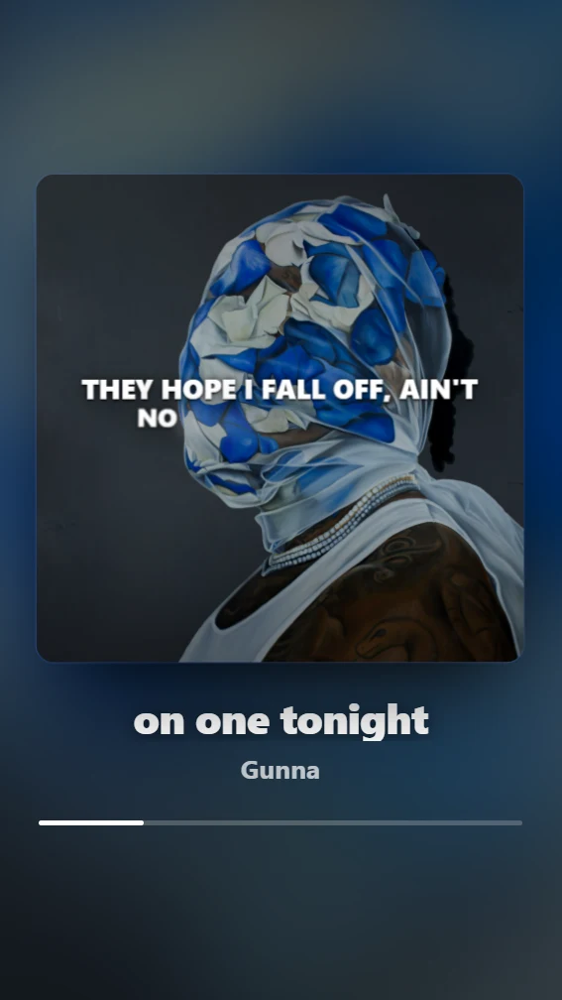
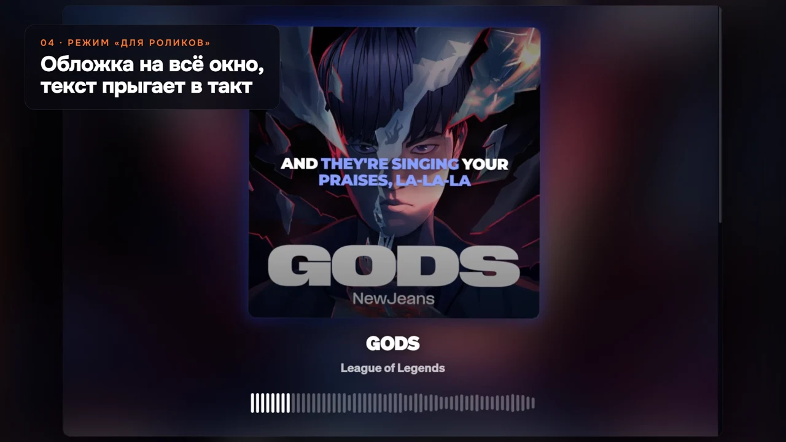
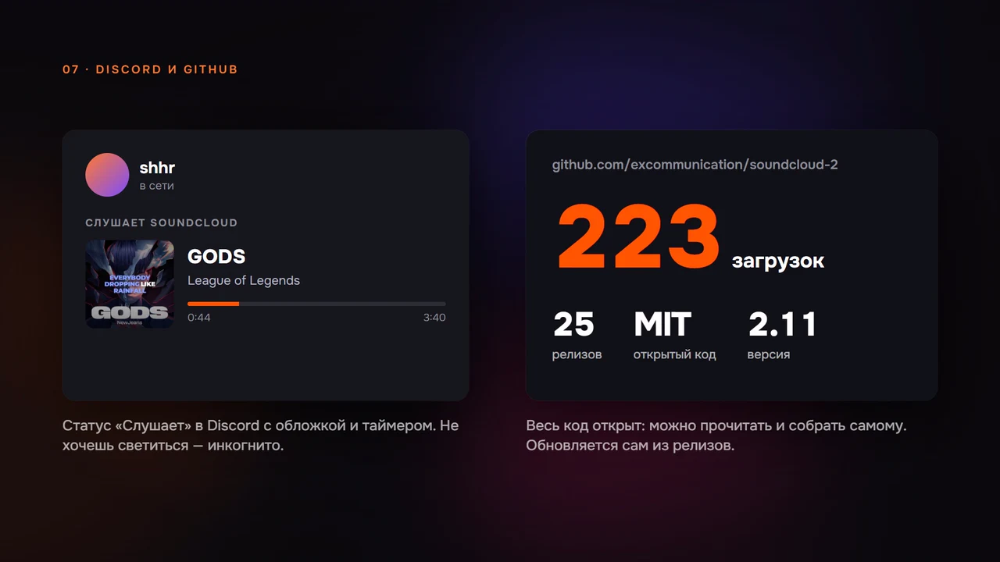
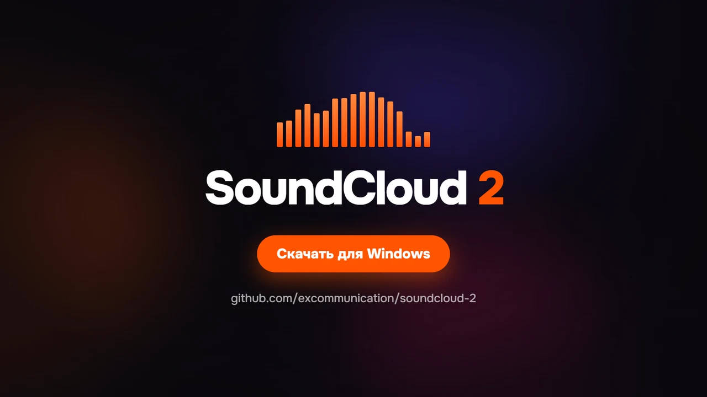

<div align="center">


# SoundCloud 2

*Десктопный клиент SoundCloud для Windows. «Моя волна», текст песен на обложке и режим для роликов.*

[](https://github.com/excommunication/soundcloud-2/releases/latest)
[](https://github.com/excommunication/soundcloud-2/releases)
[](LICENSE)

<br>

<a href="https://github.com/excommunication/soundcloud-2/releases/latest/download/SoundCloud-2-Setup.exe"><b>Скачать для Windows</b></a>

Один установщик, интернет для установки не нужен. Версия 2.13.1, Windows 10 и 11, x64.

</div>



Это soundcloud.com в своём окне, только с «Моей волной», которая подбирает музыку по твоим лайкам. Текст песни идёт по таймкодам, а режим для роликов делает из обложки кадр для TikTok. Клиент сам обновляется из релизов этого репозитория.

## 📻 Моя волна

Бесконечная очередь из похожего на твои лайки. Волна учится на пропусках и дослушиваниях.


- **Настрой волну словами.** Напиши «фонк в зал» или «tiktok», и клиент найдёт актуальные треки и вплетёт их в волну. Переключатель «Без русского» убирает русскоязычные треки из рекомендаций.
- **Текст песен синхронно.** Строки подсвечиваются по таймкодам. Текст ищется в LRCLIB, запасной источник: Genius. Если таймкодов нет, показывается обычный текст.
- **Карточка волны.** Трек, волна, кнопки и текст песни на обложке. Кнопка режима роликов и вертикальная громкость прямо в карточке.


## ✨ Хотбары, стекло и анимации

Нижний бар с лайком, дизлайком, очередью, громкостью и режимом роликов. Всё, что нужно под рукой, без лишних окон.


- **Плавная смена трека.** В «Моей волне» прошлые название и обложка уезжают, новые въезжают следом, волна трека вырастает.
- **Под бит.** Обложка трясётся и подсвечивается на ударах баса, фон дышит, на каждой новой строке текста толчок. Темп клиент определяет по звуку.
- **Переливы WebGL и стекло.** Живой фон за сайтом в цветах играющей обложки, панели поверх него стеклянные.
- **Вертикальная громкость.** Один ползунок над значком: тянуть, крутить колесом, стрелками. Щелчок по значку выключает звук.
- **Тихие края и плавные стыки.** Тишина в начале и в конце трека перематывается, следующий трек плавно набирает громкость.

## 📊 История

Журнал прослушиваний лежит только на твоём компьютере. Экран «История» показывает время, прослушивания, артистов и дни подряд за выбранный период: 7 дней, 30 дней, год или всё время.



Ниже графика идут топы артистов, треков и жанров, а также график «Когда ты слушаешь» по часам суток.

## 🗓 Итоги и титулы

Итоги недели, месяца и года — это карточки 9:16 в цветах обложки. Каждая сохраняется в PNG. Кнопка «Итоги месяца» стоит прямо на экране «История».

Карточки для недели и месяца идут по порядку: неделя, артист, трек и твой характер.


В окне итогов выбираешь неделю, месяц или год, прошлый период и цвет карточек. Потом копируешь или сохраняешь картинку.



<table>
  <tr>
    <td width="40%" valign="top">
      
    </td>
    <td width="60%" valign="top">
      <b>Титул</b> — характер слушателя за период. Он выводится на карточке «Твой характер».<br><br>
      Правила проверяются сверху вниз, первое подошедшее правило даёт титул. Если ни одно не подошло, будет «Свой ритм».
    </td>
  </tr>
</table>

| Титул | Когда выдаётся |
|---|---|
| **Разгон** | Меньше 5 засчитанных прослушиваний за период. |
| **Ночная сова** | 35% и больше музыки с полуночи до пяти утра. |
| **Верный фанат** | 40% и больше времени с одним артистом. |
| **На репите** | Один трек звучал 8 и больше раз, и это не меньше 20% всех прослушиваний. |
| **Исследователь** | Половина и больше артистов за период — новые для тебя, и всего артистов не меньше 8. |
| **Ранняя пташка** | 35% и больше музыки до десяти утра. |
| **Марафонец** | В среднем 3 часа музыки и больше в день. |
| **Меломан без границ** | Четыре жанра и больше, и ни один не занимает 35% и больше. |
| **Свой ритм** | Ни одно из правил выше не подошло. |

## 🎬 Режим «Для роликов»

Кнопка режима стоит в карточке «Моей волны» и в нижнем баре рядом с громкостью. Нажми её, и обложка играющего трека займёт всё окно, а текст песни пойдёт прямо по ней. Щелчок по обложке ставит трек на паузу, щелчок по строке в «Потоке» перематывает к ней. Полосу времени можно тянуть.

Два стиля текста. «Поток»: строки едут по обложке, слова текущей загораются в такт. «Удар»: одна строка капсом, слова выпрыгивают по одному.

<table>
  <tr>
    <td colspan="2" valign="top">
      <br>
      <b>Для роликов · «Поток»</b><br>
      <sub>Строки едут по обложке, слова текущей загораются в такт, обложка трясётся под бит.</sub>
    </td>
  </tr>
  <tr>
    <td width="40%" valign="top">
      <br>
      <b>Кадр 9:16 · «Удар»</b><br>
      <sub>Вертикальный кадр для TikTok и Reels, слова выпрыгивают по одному.</sub>
    </td>
    <td width="60%" valign="top">
      <br>
      <b>Для роликов · «Удар»</b><br>
      <sub>Обложка на весь кадр, текст прыгает в такт музыке.</sub>
    </td>
  </tr>
</table>

Внизу панель: соседние треки, перемотка на 10 секунд, пауза, громкость и лайк. Обе панели прячутся, когда мышь не двигается две секунды, поэтому в ролик они не попадают.

Кнопка записи (<kbd>R</kbd>) снимает кадр со звуком трека в MP4 и кладёт файл в `Видео\SoundCloud Clips`: после отсчёта 3-2-1, остановка тем же R или Esc. В кадре 9:16 ролик выходит 1080×1920, сразу под TikTok.

| Клавиша | Действие |
|---|---|
| <kbd>V</kbd> | Кадр 9:16 по центру: во всю высоту окна, в узком окне во всю ширину |
| <kbd>L</kbd> | Стиль текста: «Поток» → «Удар» → без текста |
| <kbd>P</kbd> | Текст сбоку: обложка слева чистая, текст отдельной колонкой справа (в 9:16 под обложкой) |
| <kbd>H</kbd> | Спрятать или показать подписи и полосу времени |
| <kbd>F</kbd> | Полный экран |
| <kbd>R</kbd> | Запись ролика в MP4, с <kbd>Shift</kbd> ровно 15 секунд |
| <kbd>B</kbd> | Эффекты бита: расслоение цвета, кольца, искры, толчки |
| <kbd>Q</kbd> | Значок sc2 в углу кадра: QR-код на репозиторий с живым значком клиента посередине |
| <kbd>M</kbd> | Выключить или включить звук |
| <kbd>N</kbd> | Следующий трек, с <kbd>Shift</kbd> предыдущий |
| <kbd>Пробел</kbd> | Пауза и продолжение |
| <kbd>←</kbd> <kbd>→</kbd>, колесо мыши | Перемотка на 5 секунд, с <kbd>Shift</kbd> на 15 |
| <kbd>Esc</kbd> | Остановить запись; иначе свернуть режим (в полном экране первый Esc выходит из него) |

## 💿 Установщик

`SoundCloud-2-Setup.exe` — единственный установщик. Окно установки вшито в него, поэтому для установки интернет не нужен. Имя файла в каждом релизе одно и то же.


## 💬 Discord

Клиент показывает в Discord статус «Слушает». Есть режим инкогнито.

<br>
<sub>Карточка статуса в Discord: обложка, трек и таймер. Инкогнито прячет её.</sub>

<br>
<sub>Слева статус в Discord, справа открытый код: 223 загрузки, 25 релизов, версия 2.11.</sub>

## 🧩 Ещё

- 📡 **Пятничный радар.** Выпуск новых релизов от артистов, которых ты слушаешь, с архивом.
- 🔐 **Вход через браузер.** Google не пускает во встроенные окна, поэтому клиент предлагает войти в обычном браузере и забирает сессию оттуда (`Ctrl+Shift+L`). Вход по почте, Apple и Facebook работают в окне клиента как обычно. Подробности в [FAQ](#-faq).
- ⬆️ **Автообновление.** Новая версия скачивается в фоне и ставится, когда ты закроешь клиент. Проверить вручную можно кнопкой «Проверить сейчас».

История изменений по версиям лежит в [релизах](https://github.com/excommunication/soundcloud-2/releases).

## 🛠 Открытый код и сборка из исходников

Проект открытый, лицензия MIT.

Нужны Windows 10 или 11 (x64), Node.js 24 и pnpm. Версия pnpm закреплена в `package.json` (поле `packageManager`).

```bash
pnpm i               # зависимости
pnpm dev             # запуск клиента из исходников
pnpm test            # тесты
pnpm typecheck       # проверка типов
pnpm build-setup     # окно установки, вшивается в установщик (как в CI)
pnpm build-win       # установщик: build/SoundCloud-2-Setup.exe
```

Сборка, которую запускает CI, описана в `.github/workflows/release.yml`. Релиз по тегу `vX.Y.Z` выкладывает один установщик `SoundCloud-2-Setup.exe` и `latest.yml` с blockmap для автообновления.

## ❓ FAQ

**SmartScreen пишет «Windows защитила ваш компьютер».** Сборка подписана только VMP-подписью Castlabs для Widevine, сертификата издателя Windows у неё нет. Нажми «Подробнее» → «Выполнить в любом случае».

**Где настройки и история?** В `%APPDATA%\soundcloud-desktop`. Там лежат настройки, журнал волны и история. Другие клиенты SoundCloud на компьютере эта папка не трогает. Окно настроек открывается клавишей <kbd>F1</kbd>.

**Как войти через Google.** Google не пускает во встроенные браузеры и приложения вроде Electron: окно клиента пишет, что приложение небезопасно, ещё до ввода пароля. Обойти это нельзя, поэтому клиент сам открывает диалог «Вход через браузер» (его же вызывает `Ctrl+Shift+L`):
1. Нажми «Открыть SoundCloud» и войди там через Google в своём обычном браузере.
2. Поставь расширение [Cookie-Editor](https://cookie-editor.com/) (кнопка «Расширение»), открой его на странице soundcloud.com и нажми Export → JSON. Всё скопируется в буфер обмена.
3. Вернись в клиент и нажми «Войти из буфера». Страница перезагрузится уже с твоим входом.

Клиент берёт из буфера только две cookie входа, `oauth_token` и `oauth_refresh_token`, и никуда их не отправляет. Первая живёт сутки, вторая продлевает её, поэтому нужен именно экспорт через Cookie-Editor: одного токена хватит на день. Войти можно и по почте: если аккаунт создавался через Google, «Забыли пароль?» на странице входа задаст к нему пароль.

**Память растёт, если много пропускать треки.** Плеер самого SoundCloud копит скачанное аудио после каждого пропуска. Клиент следит за этим и сам перезагружает страницу, когда она раздулась и музыка на паузе (или в крайнем случае прямо во время игры): очередь и позиция трека возвращаются сами.

**Текст песни не нашёлся.** LRCLIB и Genius знают не все треки. В этом случае показывается текст без подсветки, либо текста нет совсем.

**Почему в релизе один exe?** С 2.10.0 `SoundCloud-2-Setup.exe` — единственный установщик: окно установки вшито в него, интернет для установки не нужен. Имя файла в каждом релизе одно и то же.

## 🎞 Полный ролик

Ролик на 50 секунд со всеми фичами: [promo/sc2-promo.mp4](promo/sc2-promo.mp4). В нём нет музыки.

<br>
<sub>Финал ролика: кнопка «Скачать для Windows» и репозиторий github.com/excommunication/soundcloud-2.</sub>

## 📄 Лицензия

Проект распространяется по лицензии [MIT](LICENSE). Он основан на [soundcloud-desktop](https://github.com/zxczxczxczxczxczxc1111/soundcloud-desktop) и не связан с SoundCloud. Товарный знак SoundCloud принадлежит его владельцу.
