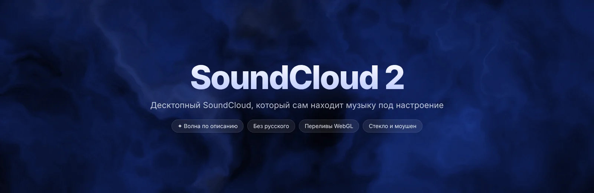
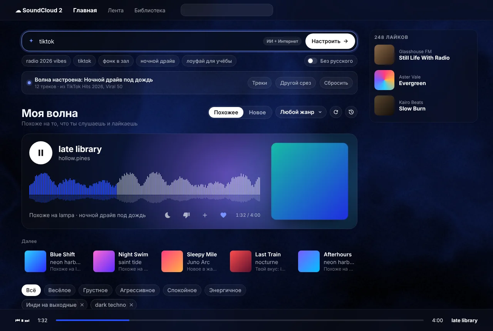
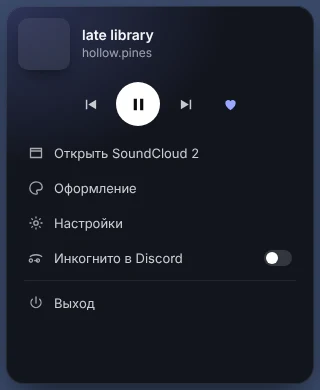
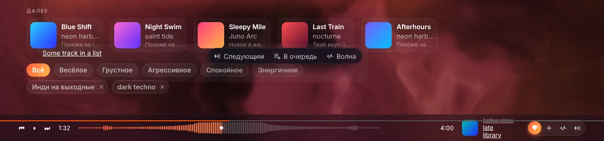
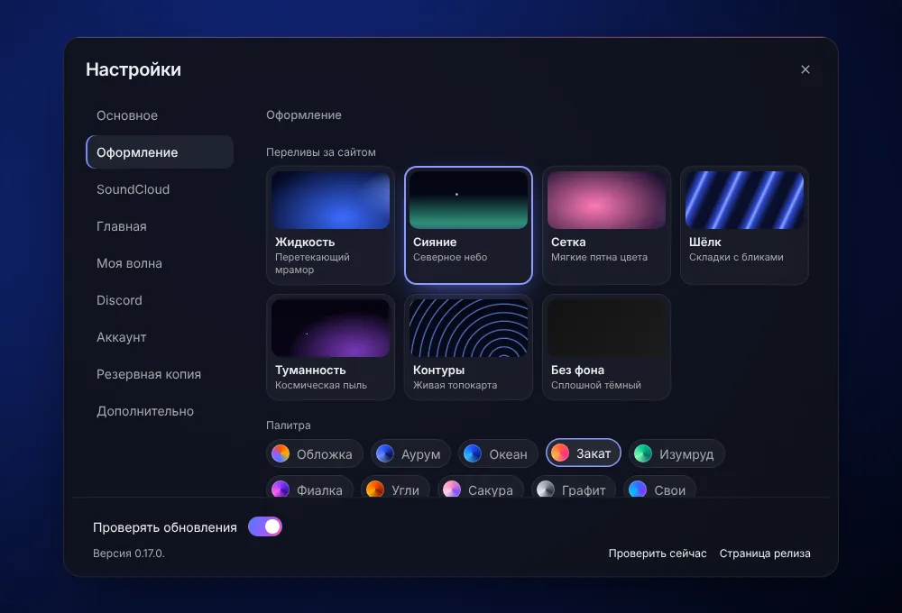
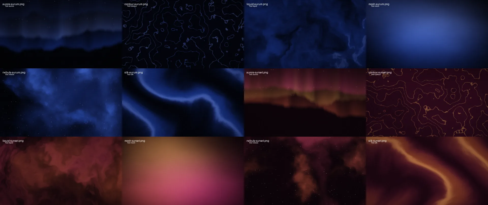
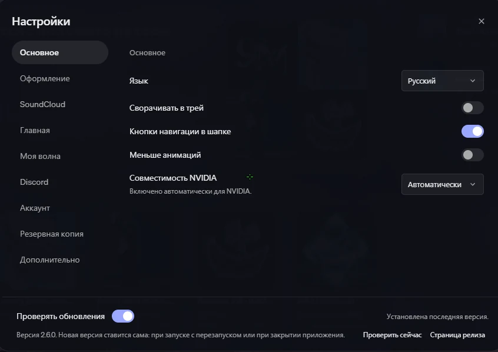
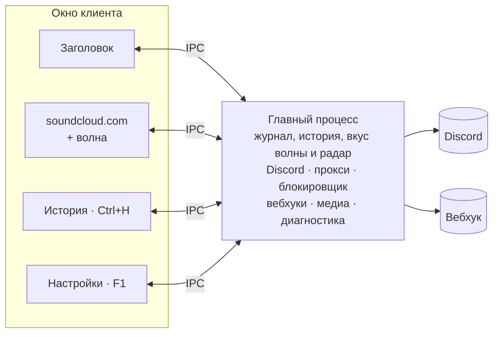

<div align="center">



<br>

<a href="https://github.com/excommunication/soundcloud-2/releases/latest"></a>

<sub>Для Windows 10 и 11 x64 · обновления оригинала подтягиваются сами</sub>

<a href="#настроить-волну">Настроить волну</a>&emsp;<a href="#без-песен-на-русском">Без русского</a>&emsp;<a href="#оформление">Оформление</a>&emsp;<a href="#моя-волна">Моя волна</a>&emsp;<a href="#история">История</a>&emsp;<a href="#установка">Установка</a>

</div>

<br>



Это soundcloud.com в своём окне, только умнее и красивее. Пишешь словами, что хочешь услышать, и клиент сам собирает топ треков и дальше ведёт волну похожим. Песни на русском можно убрать из рекомендаций одним переключателем. За сайтом переливается живой фон на WebGL в цветах играющей обложки, панели поверх него стеклянные.

Всё остальное тоже на месте: своя «Моя волна» по твоему вкусу, подборки на день, радар релизов, история прослушиваний, Discord и плавные стыки треков. Журнал прослушиваний лежит только у тебя на компьютере.

> [!TIP]
> Основано на [soundcloud-desktop](https://github.com/zxczxczxczxczxczxc1111/soundcloud-desktop). Новое в SoundCloud 2 собрано в разделе «Что нового», дальше идут возможности оригинала.

## ✦ Что нового

### Настроить волну

Над «Моей волной» строка: пишешь словами, что хочешь, и волна подстраивается. Списка, который надо пролистывать, нет, найденное просто начинает играть вперемешку с похожим.

- **Актуальное из интернета.** «tiktok», «radio 2026 vibes» или «фонк в зал» клиент ищет в открытых плейлистах и чартах Deezer (без аккаунта и ключа) и берёт оттуда реальные треки, которые сейчас слушают. Трек, который встречается в нескольких плейлистах, стоит выше. Потом клиент находит эти треки на SoundCloud.
- **Без мусора.** slowed, sped up, nightcore, bass boosted и «tiktok version» не попадают в волну, пока о них не попросишь.
- **Понимает просьбы**: сцены и настроения, жанры по-русски и по-английски, «хиты» или «андеграунд», «новое», «без русского», «в стиле X».
- **Модель по желанию.** <kbd>F1</kbd> → Моя волна → Настроить волну: OpenAI, Anthropic, OpenRouter, Groq, локальная Ollama или свой адрес. Модель помогает со сложными запросами и подсказывает треки, а интернет-поиск работает и без неё. Ключ хранится зашифрованным (safeStorage).
- **После запроса** появляется карточка «Волна настроена» с источниками: можно посмотреть треки, взять другой срез или сбросить волну обратно.

<details>
<summary><b>Как подключить модель</b></summary>

| Провайдер | Что нужно | Модель по умолчанию |
|---|---|---|
| OpenAI | ключ с platform.openai.com | `gpt-4.1-mini` |
| Anthropic | ключ с console.anthropic.com | `claude-haiku-4-5` |
| OpenRouter | ключ с openrouter.ai | `openrouter/auto` |
| Groq | бесплатный ключ с console.groq.com | `llama-3.3-70b-versatile` |
| Ollama | `ollama pull llama3.2` на этом компьютере | `llama3.2` |
| Свой адрес | любой OpenAI-совместимый `…/v1` | — |

Модели уходит только текст запроса и до шести твоих любимых жанров. Deezer получает только текст запроса.

</details>

### Живой нижний бар

- **Линия прогресса под музыку**: вместо плоской полосы тонкий спектр играющего трека, бас в середине, двигается мягко. Сыгранная часть в цветах обложки. Перемотка кликом работает как раньше.
- **Действия прямо в баре**: рядом с треком «Не нравится», «Больше такого», «Волна от трека» и «Следующим». Лайк сайта остаётся на месте.
- **Правый клик по бару**: по названию открывается меню трека (волна, очередь, «Не сейчас», версии, «Скопировать ссылку»), по автору меню артиста (волна по автору, все треки, скрыть, ссылка).
- **Быстрые действия у треков**: задержи курсор на строке трека в ленте или списке, и появятся три иконки: «Следующим», «В очередь», «Волна». На крупных строках они стоят поверх обложки и не закрывают трек; в боковых колонках их нет.
- **Лайк и дизлайк с анимацией**: на лайке из кнопки разлетаются точки в цветах обложки и звучат две ноты вверх, на дизлайке кнопка «мотает головой», вниз осыпаются серые точки, две ноты вниз. Звук выключается в Оформлении.
- **Когда играет музыка**, над баром светится полоса в цвет обложки, на дропе чуть ярче. На паузе обложки немного уменьшаются и притухают.

### Меню трея и быстрый доступ к оформлению

- Правый клик по значку в трее открывает окошко в стиле клиента: играющий трек с обложкой, управление, лайк, «Открыть», «Оформление», «Настройки», «Инкогнито в Discord» и «Выход». В режиме совместимости NVIDIA, где отдельные окна ненадёжны, вместо него системное меню с тем же: трек, управление, лайк, «Оформление».
- В шапке окна рядом с настройками кнопка-палитра: она открывает <kbd>F1</kbd> сразу на разделе «Оформление».





### Треки, которые не играют, заменяются сами

Сайт пропускает отрывки Go+ (без подписки только 30 секунд), закрытые в стране треки и треки лейблов с защищённым потоком, если Widevine в сборке не работает. SoundCloud 2 следит за текущим треком и тремя следующими в очереди: если трек не сыграет целиком, клиент находит на SoundCloud другую загрузку той же песни (та же версия, близкая длительность) и тихо ставит её на место. Работает в волне, плейлистах и лайках. Что поток не играет, клиент замечает сам по первому сорвавшемуся треку.

Чтобы треки лейблов играли в оригинале, сборке нужна VMP-подпись Widevine. Её даёт бесплатный аккаунт Castlabs EVS: секреты `EVS_ACCOUNT_NAME` и `EVS_PASSWD` в настройках репозитория, а остальное сделает релизная сборка.

### Без песен на русском

Переключатель «Без русского» стоит рядом со строкой поиска и дублируется в <kbd>F1</kbd> → Моя волна. Песни на русском уходят из подбора волны, подборок, выдачи по описанию и из очереди впереди. Клиент узнаёт их по кириллице в названии, нике или поле издателя и по меткам вроде `russian rap`. Украинский, белорусский и казахский по своим буквам не считаются русским, инструменталы остаются. «Моя музыка», то есть твои лайки и плейлисты, играет как есть.

### Оформление

За сайтом идут живые переливы на WebGL, панели поверх них стеклянные. Всё настраивается в <kbd>F1</kbd> → Оформление и применяется сразу, без перезагрузки:

- **Эффект**: «Жидкость» (перетекающий мрамор), «Сияние», «Сетка», «Шёлк», «Туманность», «Контуры» или «Без фона».
- **Палитра**: по умолчанию «Вайс». «Обложка» берёт цвета у играющего трека и плавно перетекает при смене трека. Есть ещё восемь готовых палитр и свои три цвета.
- **Под музыку, без мигания**: фон слушает трек и ускоряется, когда ритм становится плотнее или трек громче своей средней громкости, на дропе разгоняется сильнее и чуть светлеет, потом так же плавно успокаивается. Вспышек на каждом ударе нет. Ползунок «Под бит» задаёт силу, 0 выключает. Звук клиент снимает анализатором с регулятора громкости сайта и ничего в нём не меняет. У треков с защищённым потоком ритм берётся из формы волны.
- **Стиль Vice**: фирменный градиент в духе Vice City из GTA VI (кобальт, маджента, розовый, оранжевый, золото) на главных кнопках, кнопке волны и активных чипах; по кнопке пробегает блик. Карточки большие: «сейчас играет» с размытой обложкой трека в фоне и бегущей рамкой, пока играет музыка; «Далее» и подборки как карточки-обложки, которые приподнимаются и чуть увеличивают картинку; за курсором по карточке ходит мягкая подсветка. Тот же стиль в доке бара, меню, тостах, <kbd>F1</kbd> и меню трея.
- **Скорость, яркость, зерно**, «Тише на паузе» (без музыки фон замедляется и притухает), лёгкий параллакс за курсором.
- **Стекло**: плотность панелей, размытие под ними и скругления интерфейса.
- **Моушен**: карточки приподнимаются на наведении, кнопки пружинят, у строки поиска переливается рамка. «Меньше анимаций» и системная настройка движения всё это выключают.
- **Качество**: «Эко», «Баланс» или «Максимум». Фон рисуется в пониженном разрешении с ограничением кадров, а на свёрнутом окне не рисуется вовсе.





<sub>Сверху вниз и слева направо: сияние, контуры, жидкость, сетка, туманность, шёлк в палитре «Аурум», затем те же в «Закате».</sub>

### Обновления оригинала

Раз в день GitHub Actions забирает свежий main [оригинала](https://github.com/zxczxczxczxczxczxc1111/soundcloud-desktop) и сливает его сюда, не трогая своё:

- `package.json` берётся у оригинала с его зависимостями и скриптами, поверх снова накладываются поля форка из `scripts/fork.json`: имя установщика, репозиторий обновлений, автор.
- README и картинки остаются нашими, lock-файл берётся у оригинала, ссылки на репозиторий переписываются на этот.
- После слияния прогоняются типы, линтер и тесты. Если всё прошло, версия поднимается на патч (2.0.0 → 2.0.1) и собирается релиз, а клиент подтягивает его сам.
- Если оригинал поменял те же места, что и SoundCloud 2, или что-то сломалось, main не трогается и появляется issue со списком файлов.

Запустить вручную: вкладка Actions → «Обновления из оригинала» → Run workflow. Локально: `node scripts/sync-upstream.cjs --dry-run`.

## Моя волна


Жмёшь play, и клиент собирает бесконечную очередь из похожего на то, что ты слушаешь и лайкаешь. Пока трек играет, очередь догружается, один артист не идёт подряд, а под треком подписано, почему он в волне. За блоком волны медленно плывут мягкие пятна цветов обложки, на паузе они замирают. Что ещё умеет волна:

- **Похожее или новое**: «Похожее» подбирает треки вокруг твоих лайков и истории, «Новое» берёт треки в твоём вкусе, которых ты ещё не слышал. Жанры можно задать своими словами: `techno, dark techno`.
- **Настроение**: под очередью волны пресеты «Весёлое», «Грустное», «Агрессивное», «Спокойное» и «Энергичное». Пресет действует со следующего трека и запоминает, что ты пропускаешь именно в нём.
- **Вкус по тому, как ты слушаешь**: дослушанный трек, пропуск в первые 30 секунд и лайк меняют то, что волна поставит дальше. Ранний пропуск сразу убирает похожее впереди, три пропуска подряд меняют курс, после лайка похожие встают ближе. Утром, днём, вечером и ночью вкус у волны свой, а ещё она помнит, на каком языке ты слушаешь. Свою картину твоего вкуса и то, насколько она попадает, волна показывает на странице истории.
- **Пропуски с общей чертой**: если подряд пропускаешь slowed, инструментал или один жанр, волна до конца сессии ставит такое реже и называет черту на плашке. После трёх быстрых пропусков вместо следующего трека появляется «Куда дальше?»: до пяти треков в разные стороны.
- **«Больше такого», «Не сейчас» и «Не нравится»**: кнопки у играющего трека. Первая добавляет в волну похожее, вторая убирает трек на неделю, третья насовсем, а плашка после них даёт отменить. Из меню по правой кнопке так же убирается артист, а «Не показывать аккаунт» скрывает его насовсем.
- **Волна от чего угодно**: нажми правой кнопкой на трек, артиста, плейлист или жанр (метку трека, страницу жанра, карточку жанра в подборках), и волна начнётся от него. Когда похожее кончится, продолжит станция трека. «Все треки артиста» в том же меню играет только его каталог, вместе с песнями на чужих каналах.
- **Закрепления**: плейлист, артиста или жанр можно закрепить на главной из того же меню, до 12 штук. Закрепления стоят рядом с пресетами и включают волну от себя одним нажатием.
- **«Встряхнуть»**: меняет треки впереди, играющий не прерывается.
- **Версии трека**: волна различает оригинал, slowed, sped up, ремиксы и лайвы, а перезалив той же версии второй раз не ставит. «Версии этого трека» в меню покажет остальные, «Скрыть другие версии» уберёт их из волны и радара.
- **Плавные стыки**: тишину в начале и конце трека клиент проматывает, а следующий трек вступает поверх последних секунд текущего. Переход работает на всём, что играет в клиенте, и на треках лейблов с защищённым потоком тоже. Длина перехода от 1 до 12 секунд, оба пункта выключаются в <kbd>F1</kbd> → SoundCloud.

### Моя музыка

Под волной блок с твоими лайками и плейлистами, своими и сохранёнными. В «Источниках» выбираешь, что играть, можно сразу несколько. Выбранное подсвечено, а значок волны стоит у источника, откуда играет текущий трек. Порядок: «По порядку», «Перемешать» (один артист не идёт подряд, треки, игравшие последние 3 дня, уходят в конец) или «Умное перемешивание», где после каждых трёх своих треков идёт похожий, которого у тебя ещё нет.

Источники и порядок можно менять во время игры: текущий трек не прерывается, меняются только треки впереди. В статусе число треков, которые сыграют целиком, а отрывки Go+ и закрытое в стране идут отдельной пометкой: «377 треков, 69 недоступны».


### Подборки на каждый день

Ниже каждый день новая полка:

- **Радар релизов и новые загрузки**: первыми на полке, подробнее [ниже](#радар-релизов).
- **Плейлист момента**: «Утро четверга», «Ночь на пятницу» и так далее. До 50 треков из твоих лайков и слышанного, которые ты любишь в это время суток.
- **Разведка**: треки, которых ты ещё не слышал, из похожих на любимое и из лайков слушателей с похожим вкусом. Каждый играет 20 секунд с самого яркого места: «Оставить» дослушивает его, «Дальше» переключает. Список меняется в полночь.
- **Лайкнули твои артисты**: треки из подборок лайков артистов, которых ты слушаешь.
- **Давно не слушал**: твои лайки, которые давно не звучали, первыми те, что ты дослушивал и крутил на повторе. Каждый день новая выборка, а повторный запуск продолжает с места.
- **Твои вкусы**: клиент делит лайки и то, что ты дослушиваешь, по жанрам, до восьми групп. У каждой своя волна и каждый день своя выборка треков, туда же подмешиваются свежие треки каналов этого жанра.
- **Набор**: выбери до пяти треков пунктом «Добавить в набор» в меню, и волна пойдёт от них.

Нажми на карточку, и под полкой раскроется её список, даже в маленьком окне он сам встанет в поле зрения. Любой трек из него можно включить первым, а за ним пойдёт остальная подборка.


Полки сайта на главной скрыты, волна их заменяет. Вернуть любую можно в настройках: <kbd>F1</kbd> → Главная.

Треки Go+, которые без подписки играют 30 секунд, и миксы длиннее 15 минут в волну не попадают.

### Очередь и продолжение прослушивания

Кнопка очереди в шапке открывает список треков. В меню трека можно поставить его следующим или добавить в конец, а будущие треки в очереди переставлять и удалять. Очередь можно сохранить и включить позже из «Сохранённых очередей»; плейлист в аккаунте SoundCloud при этом не создаётся.


После перезапуска клиент восстанавливает очередь, источник волны и позицию, а музыку держит на паузе, пока ты не нажмёшь play. При временном сбое сети показывает статус и повторяет подключение, сохраняя очередь. Если страница упала, зависла или открылась без сети, клиент поднимает её сам.

## Радар релизов

Каждую субботу в 3:00 клиент собирает выпуск: что вышло с прошлого выпуска у тех, на кого ты подписан, и у артистов, которых ты слушаешь. Другие аккаунты артиста клиент находит сам по точному имени, а трек на чужом канале, если артист указан в названии или титрах. Релиз, который нашёлся уже после прошлого выпуска, войдёт в следующий.

- **Сначала твоё**: наверху треки, связанные с твоим вкусом, в конце до 10 открытий по твоим жанрам. От одного канала в выпуске не больше трёх треков.
- **Каналы на полке**: сборные каналы, которые выкладывают чужую музыку, в выпуск не идут. Их свежие треки попадают в карточки твоих жанров на полке.
- **Новые загрузки отдельно**: если канал за неделю выгрузил пачку треков без даты релиза, клиент считает её старым каталогом. Два лучших трека остаются в выпуске, остальные уходят в свою карточку. Фанатские ремиксы и эдиты чужих песен тоже живут отдельно, в карточке «Ремиксы и эдиты».
- **Строка на исполнителя**: несколько треков одного артиста собраны в одну строку. Метка альбома или «+N» раскрывает остальные, «Слушать все» ставит их следующими.
- **«Уже слышал»**: треки, которые ты уже слушал или лайкнул, клиент помечает и ставит в конец выпуска.
- **Архив и «Все найденные»**: прошлый выпуск выбираешь в списке над треками, а «Все найденные» покажут всё, что клиент нашёл за неделю, с фильтром по релизам и загрузкам.


Выпуск играет по порядку, после него волна продолжает похожим. День и время выпуска меняешь в <kbd>F1</kbd> → Моя волна. Если в это время клиент был закрыт, он соберёт выпуск при следующем запуске.

## История

История показывает, сколько и что ты слушал в клиенте и какой вкус из этого сложился у волны. Открывается кнопкой с часами в шапке окна или по <kbd>Ctrl</kbd> + <kbd>H</kbd>. Что на странице:

- **Сколько музыки**: за неделю, месяц, год или всё время, по дням и часам. Журнал любого дня и поиск по всему, что ты слушал. Нажатие на трек включает его.
- **Топы**: артисты, треки и жанры, а ещё карта того, в какие часы и дни ты слушаешь.
- **Вкус глазами волны**: артисты и теги, на которые она опирается. Лишнего артиста или тег можно убрать из вкуса.
- **Как попадает волна**: сколько треков волны ты пропускаешь в первые 30 секунд и сколько дослушиваешь, рядом со своей музыкой и прошлым периодом. Там же лайки, «Больше такого», отказы, новые артисты, пропуски по дням и разбор по подборкам, причинам подбора и месту трека в очереди.
- **Сводка недели**: карточка с часами музыки, топом треков и артистов, любимыми жанрами и самой музыкальной частью суток. Восемь цветов на выбор, картинку можно скопировать или сохранить. Когда сводка прошлой недели готова, у кнопки истории загорается точка.


<table>
  <tr>
    <td width="50%" valign="top"></td>
    <td width="50%" valign="top"></td>
  </tr>
  <tr>
    <td valign="top"><sub>Жанры и карта: в какие часы и дни недели ты слушаешь</sub></td>
    <td valign="top"><sub>Артисты, которых волна ставит чаще</sub></td>
  </tr>
</table>


Трек засчитывается с 30 секунд звука. История своя у каждого аккаунта и лежит в `%APPDATA%\soundcloud-desktop`.

<sub>На снимках выдуманные исполнители, треки и обложки.</sub>

## Что ещё есть в клиенте

Остальное, что клиент добавляет к сайту:

<table>
  <tr>
    <td width="33%" valign="top">
      <br>
      <b>Discord Rich Presence</b><br>
      <sub>Друзья видят, что ты слушаешь. Строки карточки собираешь сам, артистов и жанры можно скрыть.</sub>
    </td>
    <td width="33%" valign="top">
      <br>
      <b>Без рекламы</b><br>
      <sub>Рекламу убирает блокировщик Ghostery. Промо и зазывания в Artist Pro тоже скрыты.</sub>
    </td>
    <td width="33%" valign="top">
      <br>
      <b>Управление из Windows</b><br>
      <sub>Превью на панели задач показывает обложку, трек и ход игры, под ним лайк и переключение треков. Медиаклавиши, трей.</sub>
    </td>
  </tr>
  <tr>
    <td valign="top">
      <br>
      <b>Плавный SoundCloud</b><br>
      <sub>Обложки проявляются поверх своего цвета, страницы въезжают без рывков, вместо спиннеров заготовки.</sub>
    </td>
    <td valign="top">
      <br>
      <b>Русский и английский</b><br>
      <sub>Сайт и весь клиент на двух языках, язык переключается в настройках.</sub>
    </td>
    <td valign="top">
      <br>
      <b>Несколько аккаунтов</b><br>
      <sub>Основной и второй аккаунт в одном клиенте, у каждого своя волна и история.</sub>
    </td>
  </tr>
  <tr>
    <td valign="top">
      <br>
      <b>Инкогнито</b><br>
      <sub><kbd>Ctrl</kbd> + <kbd>Shift</kbd> + <kbd>N</kbd> прячет трек из Discord. Волна и история работают как обычно.</sub>
    </td>
    <td valign="top">
      <br>
      <b>Прокси</b><br>
      <sub>HTTP-прокси с логином и паролем. Пароль Windows хранит в зашифрованном виде.</sub>
    </td>
    <td valign="top">
      <br>
      <b>Вебхуки</b><br>
      <sub>Трек доиграл до нужного процента, и клиент шлёт его данные в JSON на твой адрес.</sub>
    </td>
  </tr>
  <tr>
    <td valign="top">
      <br>
      <b>Диагностика</b><br>
      <sub>По журналу видно, где сломалось. Треков, адресов и паролей в нём нет.</sub>
    </td>
    <td valign="top">
      <br>
      <b>Резервная копия</b><br>
      <sub>История, отметки волны, вкус, подборки, архив радара и настройки в одном файле. Автокопия раз в неделю в твою папку.</sub>
    </td>
    <td valign="top">
      <br>
      <b>Ссылки в поиске</b><br>
      <sub>Вставь в поиск ссылку на трек, плейлист или профиль, и откроется его страница. Короткие ссылки из телефона тоже.</sub>
    </td>
  </tr>
</table>

Всё это включается и настраивается в окне по <kbd>F1</kbd> или по шестерёнке в шапке:



## Установка

Бери установщик `soundcloud-2-<версия>-setup-x64.exe` на странице [последнего релиза](https://github.com/excommunication/soundcloud-2/releases/latest). Рядом лежит `SHA256SUMS`, если захочешь сверить файлы.

Клиент обновляется сам из релизов этого репозитория: новую версию качает в фоне и ставит, когда ты его закрываешь. Поверх установленного оригинала он встаёт как обновление, история и настройки сохраняются. Выключить это можно переключателем «Проверять обновления» внизу настроек.

Профиль клиента лежит в `%APPDATA%\soundcloud-desktop`, другие клиенты SoundCloud на компьютере он не трогает.

На Windows с обнаруженной NVIDIA автоматически включается режим совместимости для плавной работы. Выбор можно изменить: <kbd>F1</kbd> → Основное → Совместимость NVIDIA. Изменение применяется после перезапуска.

> [!NOTE]
> При первом запуске Windows SmartScreen может ругнуться. Сборка подписана VMP-подписью Widevine, а подписи издателя Windows у неё нет.

<details>
<summary><b>Горячие клавиши</b></summary>

| Клавиши | Действие |
|---|---|
| <kbd>F1</kbd> | Открыть или закрыть настройки |
| <kbd>Ctrl</kbd> + <kbd>H</kbd> | Открыть или закрыть историю |
| <kbd>Esc</kbd> | Закрыть настройки или историю |
| <kbd>Ctrl</kbd> + <kbd>B</kbd> или <kbd>Ctrl</kbd> + <kbd>P</kbd> | Назад |
| <kbd>Ctrl</kbd> + <kbd>F</kbd> или <kbd>Ctrl</kbd> + <kbd>N</kbd> | Вперёд |
| <kbd>Ctrl</kbd> + <kbd>R</kbd> | Обновить страницу |
| <kbd>Ctrl</kbd> + <kbd>L</kbd> | Лайк играющего трека |
| <kbd>Ctrl</kbd> + <kbd>D</kbd> | «Не сейчас» у играющего трека |
| <kbd>Ctrl</kbd> + <kbd>M</kbd> | «Больше такого» у играющего трека |
| <kbd>Ctrl</kbd> + <kbd>S</kbd> | «Встряхнуть» волну |
| <kbd>Ctrl</kbd> + <kbd>Shift</kbd> + <kbd>N</kbd> | Инкогнито в Discord |
| <kbd>Ctrl</kbd> + <kbd>=</kbd> / <kbd>Ctrl</kbd> + <kbd>-</kbd> / <kbd>Ctrl</kbd> + <kbd>0</kbd> | Масштаб больше, меньше, сбросить |

</details>

<details>
<summary><b>Как устроено</b></summary>



Заголовок, страница, история и настройки это отдельные Electron-view, у каждого свой preload. Главный процесс слушает IPC только от своих окон. Журнал прослушиваний пишется в файлы профиля. История, вкус волны, радар и резервная копия считаются в фоновом потоке, данные лежат в SQLite. Если упадёт страница SoundCloud, клиент её перезагрузит, а сам не закроется.

</details>

<details>
<summary><b>Диагностика</b></summary>

Если что-то сломалось, открой настройки по <kbd>F1</kbd> и в разделе «Дополнительно» у строки «Журнал диагностики» нажми «Сохранить». Получится `.log`, его и прикладывай к описанию проблемы.

Журнал остаётся у тебя на компьютере. В нём версия сборки, ошибки, состояние плеера, нагрузка, уход в сон и падения процессов. Названий треков, адресов, паролей, токенов и текстов сообщений там нет. Клиент пишет показатели раз в 30 секунд, а когда ничего не играет и окно скрыто, раз в 5 минут. Файлов три, они перезаписываются по кругу и вместе занимают до 6 МБ.

</details>

<details>
<summary><b>Сборка из исходников</b></summary>

Нужны Windows x64 и Node.js 24.

```powershell
npx pnpm@12.15.0 install --frozen-lockfile
npx pnpm@12.15.0 typecheck
npx pnpm@12.15.0 lint
npx pnpm@12.15.0 test
npx pnpm@12.15.0 test:electron
npx pnpm@12.15.0 build-win       # установщик
```

Готовые файлы окажутся в папке `build`.

### Widevine и VMP-подпись

Защищённые треки играют через Castlabs Electron с Widevine. Для сборки понадобятся Python и бесплатный аккаунт [Castlabs EVS](https://github.com/castlabs/electron-releases/wiki/EVS):

```powershell
python -m pip install castlabs-evs==1.3.2
python -m castlabs_evs.account signup
```

VMP-подпись сборка получает и проверяет сама, а если подписать не вышло, останавливается. Тестовую сборку без подписи собирай с `SKIP_VMP_SIGNING=true`, так делает CI. Только защищённые треки в ней могут не заиграть.

</details>

<details>
<summary><b>Благодарности</b></summary>

SoundCloud 2 это форк [soundcloud-desktop](https://github.com/zxczxczxczxczxczxc1111/soundcloud-desktop) от zxczxczxczxczxczxc1111: волна, радар, история и почти всё под капотом оттуда.

В основе лежит [soundcloud-rpc](https://github.com/richardhbtz/soundcloud-rpc) Ричарда Хабицройтера, коммит `bc3b3de6c19175c614712e09c9af68bd1c226396`, его уведомление об авторских правах на месте.

</details>

<br>

<div align="center">
<sub>
Лицензия <a href="LICENSE">MIT</a>.<br>
Неофициальный клиент, к SoundCloud и Discord отношения не имеет. Их названия и логотипы принадлежат им.
</sub>
</div>
